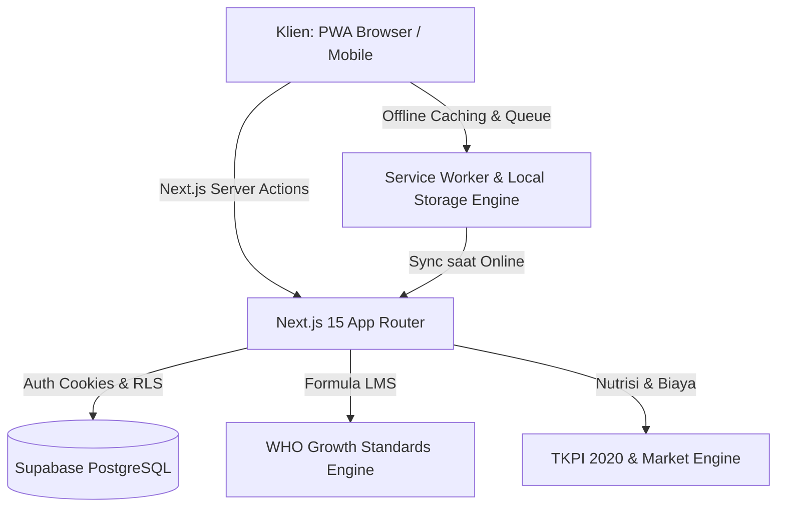

<div align="center">

  

  # GiziSmile
  ### Platform PWA Pemantauan Stunting Baku WHO & Resep Gizi Cerdas Berbasis Pasar

  [](https://nextjs.org/)
  [](https://react.dev/)
  [](https://www.typescriptlang.org/)
  [](https://tailwindcss.com/)
  [](https://supabase.com/)
  [](https://web.dev/progressive-web-apps/)
  [](https://www.who.int/tools/child-growth-standards)
  [](https://panganku.org/)

  <p align="center">
    <strong>GiziSmile</strong> adalah Progressive Web App (PWA) <em>offline-first</em> yang dirancang khusus untuk menjembatani perhitungan kurva pertumbuhan antropometri balita baku WHO dengan rekomendasi resep gizi lokal ekonomis (&lt; Rp6.000/porsi) berbasis data harga pasar harian dan standar Angka Kecukupan Gizi (AKG) Kemenkes RI.
  </p>

  <p align="center">
    <a href="#-latar-belakang--masalah"><strong>Latar Belakang</strong></a> ·
    <a href="#-fitur-unggulan"><strong>Fitur Utama</strong></a> ·
    <a href="#-peran-pengguna--1-click-demo"><strong>Akun Demo</strong></a> ·
    <a href="#-arsitektur--teknologi"><strong>Tech Stack</strong></a> ·
    <a href="#-struktur-proyek"><strong>Struktur Folder</strong></a> ·
    <a href="#-panduan-instalasi--menjalankan-lokal"><strong>Instalasi</strong></a> ·
    <a href="#-tim-pengembang"><strong>Tim Pengembang</strong></a>
  </p>

</div>

---

## 📌 Latar Belakang & Masalah

Penanganan stunting (*stunted*) dan kekurangan gizi (*wasted/underweight*) di Indonesia masih menghadapi dua kendala kritis di tingkat akar rumput:

1. **Aksesibilitas Sinyal di Daerah Terpencil (*Blank Spot*)**  
   Kader Posyandu seringkali bertugas di wilayah pedesaan atau pelosok dengan koneksi internet yang tidak stabil atau nihil, sehingga sistem berbasis web konvensional tidak dapat digunakan saat pelaksanaan Posyandu.
2. **Kesenjangan antara Diagnosa dan Intervensi Riil**  
   Sistem yang ada umumnya berhenti pada label hasil ukur (misal: "Stunting") tanpa memberikan panduan konkret yang realistis bagi orang tua berpenghasilan rendah mengenai makanan apa yang harus dimasak dengan anggaran terbatas namun padat zat gizi mikro/makro penting.

**GiziSmile hadir sebagai solusi holistik:**
- Menghadirkan **kalkulasi Z-Score antropometri instan standar WHO** (TB/U, BB/U, BB/TB) dengan kurva pertumbuhan visual.
- Menyediakan **resep gizi cerdas berbasis pasar lokal** bernutrisi tinggi (ikan lele, hati ayam, telur, tempe, daun kelor) dengan estimasi biaya presisi per porsi (&lt; Rp6.000).
- Memastikan **keandalan mode luring penuh (*offline-first*)** dengan sinkronisasi dua arah otomatis saat kembali online.
- Menyajikan **analitik agregasi sebaran stunting wilayah** dan fasilitas cetak laporan resmi Puskesmas.

---

## 🚀 Fitur Unggulan

### 1. 🧮 Kalkulator Antropometri Baku WHO (Z-Score Multi-Indikator)
- **3 Indikator Utama Pertumbuhan**:
  - **TB/U (Tinggi Badan menurut Umur)**: Deteksi *Sangat Pendek (Severely Stunted)*, *Pendek (Stunted)*, *Normal*, dan *Tinggi*.
  - **BB/U (Berat Badan menurut Umur)**: Evaluasi *Severely Underweight*, *Underweight*, *Normal*, dan *Risiko BB Lebih*.
  - **BB/TB (Berat Badan menurut Tinggi/Panjang Badan)**: Deteksi *Gizi Buruk (Severely Wasted)*, *Gizi Kurang (Wasted)*, *Gizi Baik*, *Gizi Lebih*, dan *Obesitas*.
- **Metode LMS Presisi**: Mengimplementasikan formula statistik $L$, $M$, $S$ dari *WHO Child Growth Standards* untuk anak usia 0–60 bulan.
- **Grafik Kurva Pertumbuhan Interaktif**: Visualisasi sebaran titik ukur balita terhadap rentang kurva standar deviasi ($-3$ SD hingga $+3$ SD) menggunakan Recharts.
- **Peringatan Dini Instan**: Penandaan otomatis jika anak memerlukan intervensi gizi segera.

### 2. 🍲 Resep Gizi Cerdas Berbasis Pasar Lokal (< Rp6.000/porsi)
- **Rekomendasi Berdasarkan Kondisi Defisit**: Rekomendasi otomatis diprioritaskan sesuai diagnosa anak (*Stunting*, *Wasting*, *Underweight*, atau *Gizi Seimbang*).
- **Pemberdayaan Komoditas Pangan Lokal**: Formulasi menu kaya protein hewani, zat besi ($Fe$), kalsium ($Ca$), dan zink ($Zn$) dari bahan pangan lokal yang mudah diperoleh (lele, hati ayam, telur ayam ras, tahu, tempe, kelor, bayam, pisang, dll.).
- **Perhitungan Nilai Gizi Terverifikasi TKPI 2020**: Mengacu pada *Tabel Komposisi Pangan Indonesia (TKPI 2020)* Kementerian Kesehatan RI.
- **Analisis Capaian AKG**: Menghitung persentase pemenuhan Angka Kecukupan Gizi harian balita per porsi sajian resep.
- **Transparansi Biaya Riil**: Mengintegrasikan harga komoditas pasar harian untuk menyajikan estimasi biaya akurat per porsi masakan.

### 3. 📶 Ketahanan Mode Luring Penuh (*Offline-First Resilience*)
- **PWA Berkemampuan Standalone**: Dilengkapi Service Worker (`sw.js`) dan Manifest (`manifest.json`) agar dapat diinstal di smartphone/tablet kader layaknya aplikasi native.
- **Penyimpanan Antrean Luring (Offline Queue Engine)**:
  - Input data anak baru, riwayat pengukuran, dan perhitungan Z-score tetap berjalan 100% tanpa jaringan internet.
  - Tabel referensi LMS WHO dan standar AKG dibundel secara lokal di peramban.
- **Sinkronisasi Dua Arah Terpadu (*Bidirectional Sync*)**:
  - Deteksi status koneksi otomatis (`online`/`offline`).
  - Antrean mutasi luring diproses secara sekuensial dan aman ke cloud Supabase melalui Server Actions saat internet pulih.
  - Tersedia tombol **Simulasi Offline** untuk keperluan demonstrasi dan pengujian sistem.

### 4. 📊 Dashboard Analitik Sebaran Wilayah & Cetak Laporan
- **Agregasi Kasus per Desa/Posyandu**: Pemantauan prevalensi stunting per wilayah binaan Puskesmas.
- **Visualisasi Grafik Wilayah**: Grafik perbandingan balita berstatus stunting vs normal untuk evaluasi pemangku kebijakan.
- **Fasilitas Cetak Laporan Resmi**: Tampilan bersih siap cetak (*print-friendly*) untuk pelaporan lintas sektor ke Dinas Kesehatan atau kecamatan.

### 5. 👥 Role-Based Access Control (RBAC) & Manajemen Akses
- Hak akses hierarkis dengan keamanan **Supabase Row Level Security (RLS)**:
  - **Administrator**: Registrasi dan aktivasi akun kader/ahli gizi, persetujuan permohonan peran (*role requests*).
  - **Ahli Gizi Puskesmas**: Analisis tren stunting wilayah, penambahan katalog resep intervensi gizi.
  - **Kader Posyandu**: Registrasi balita, pencatatan hasil timbang posyandu, eksekusi sinkronisasi offline.
  - **Orang Tua Balita**: Pemantauan histori tumbuh kembang anak pribadi secara privat dan eksplorasi resep.

---

## 🔑 Peran Pengguna & 1-Click Demo

Untuk memudahkan evaluasi dan pengujian oleh dewan juri/penguji, GiziSmile menyediakan fitur **1-Click Demo Login** pada halaman login:

| Peran (Role) | Email Akun Demo | Kata Sandi | Deskripsi Hak Akses |
| :--- | :--- | :--- | :--- |
| **Administrator** | `admin@gizismile.id` | `password123` | Kelola akun staf, verifikasi permohonan peran, audit sistem |
| **Kader Posyandu** | `kader@gizismile.id` | `password123` | Input balita, pengukuran Z-score offline/online, sync data |
| **Ahli Gizi** | `gizi@gizismile.id` | `password123` | Analitik stunting wilayah, tambah resep gizi, pantau intervensi |
| **Orang Tua** | `ortu@gizismile.id` | `password123` | Akses privat histori perkembangan anak dan rekomendasi resep |

> [!TIP]
> Pada halaman `/login`, cukup klik tombol peran demo yang diinginkan untuk masuk secara instan tanpa perlu mengetik kredensial secara manual.

---

## 🛠 Arsitektur & Teknologi



### Rincian Komponen Teknologi:
- **Framework Utama**: [Next.js 15](https://nextjs.org/) (App Router, React Server Components, Server Actions)
- **Library UI**: [React 19](https://react.dev/), [Tailwind CSS](https://tailwindcss.com/), [shadcn/ui](https://ui.shadcn.com/), [Lucide React](https://lucide.dev/)
- **Visualisasi Data**: [Recharts](https://recharts.org/) (Kurva Standar Pertumbuhan WHO & Grafik Prevalensi Wilayah)
- **Basis Data & Autentikasi**: [Supabase](https://supabase.com/) (PostgreSQL dengan RLS, Triggers, Security Definer Functions, Supabase SSR Auth)
- **Validasi Data**: [Zod v4](https://zod.dev/) & [React Hook Form](https://react-hook-form.com/)
- **PWA & Offline System**: HTML5 Service Worker, Web App Manifest, Cache API, Local Storage Queue Hydrator
- **Standar & Rujukan Medis**:
  - WHO Child Growth Standards (LMS parameters $L$, $M$, $S$)
  - Tabel Komposisi Pangan Indonesia (TKPI 2020) Kemenkes RI
  - Permenkes Standar Antropometri Anak Indonesia

---

## 📂 Struktur Proyek

```text
GiziSmile/
├── actions/                      # Next.js Server Actions (Data mutations)
│   ├── children.ts               # Manajemen balita & relasi orang tua
│   ├── measurements.ts           # Pencatatan pengukuran & hitung Z-score
│   ├── recipes.ts                # Pengelolaan resep gizi & bahan komoditas
│   ├── staff.ts                  # Manajemen peran & persetujuan staf
│   └── sync.ts                   # Eksekusi antrean mutasi offline sekuensial
├── app/                          # Next.js App Router
│   ├── (dashboard)/              # Rute terlindungi (Protected layout)
│   │   ├── admin/users/          # Panel Admin: Manajemen staf & peran
│   │   ├── analytics/            # Analitik stunting wilayah & cetak laporan
│   │   ├── children/             # Rekam medis balita Posyandu
│   │   ├── recipes/              # Katalog Resep Gizi Cerdas Pasar
│   │   ├── settings/account/     # Profil & pengajuan peran petugas
│   │   └── z-score/              # Kalkulator Z-score antropometri WHO
│   ├── auth/                     # Alur autentikasi (login, signup, reset password)
│   ├── layout.tsx                # Root layout & tema (Dark/Light mode)
│   └── page.tsx                  # Landing page interaktif GiziSmile
├── components/                   # Komponen antarmuka (UI Components)
│   ├── admin/                    # Komponen panel administrator
│   ├── analytics/                # Grafik prevalensi stunting Recharts
│   ├── children/                 # Tampilan data & riwayat balita
│   ├── common/                   # Komponen bersama (SimulateOfflineButton, dll.)
│   ├── layout/                   # Navbar, Sidebar, OfflineBanner
│   ├── providers/                # OfflineHydrator, OfflineAuthGuard
│   ├── recipes/                  # Kartu resep, modal tambah resep
│   ├── ui/                       # Desain atomik shadcn/ui
│   └── z-score/                  # Form Z-Score, GrowthChart, StatusBadge
├── lib/                          # Pustaka utilitas, logika inti & referensi
│   ├── offline.ts                # Engine antrean mutasi luring & caching
│   ├── offline_akg_references.json # Data referensi AKG harian balita
│   ├── recipe-engine.ts          # Algoritma kalkulasi nutrisi & AKG resep
│   ├── validators.ts             # Skema validasi Zod
│   ├── who-lms.json              # Dataset baku LMS WHO (0-60 bulan)
│   ├── zscore.ts                 # Algoritma kalkulasi Z-Score WHO
│   └── supabase/                 # Klien Supabase (server, client, admin, proxy)
├── public/                       # Aset publik, ikon PWA, Logo_GiziSmile, sw.js
├── scripts/                      # Skrip utilitas pengunduh dataset WHO LMS
├── supabase/                     # Skrip database & migrasi SQL
│   ├── migrations/               # DDL skema database GiziSmile
│   ├── schema.sql                # Definisi tabel, relasi, RLS, & trigger
│   └── seed.sql                  # Data awal TKPI 2020, komoditas, & resep
└── package.json                  # Dependensi dan skrip proyek
```

---

## 💻 Panduan Instalasi & Menjalankan Lokal

### 1. Prasyarat Sistem
- **Node.js**: Versi `20.x` atau yang lebih baru
- **Package Manager**: `npm`, `pnpm`, atau `yarn`
- Akun proyek [Supabase](https://supabase.com/) (atau Supabase CLI lokal)

### 2. Kloning Repositori
```bash
git clone https://github.com/InTroubleWh/GiziSmile.git
cd GiziSmile
```

### 3. Instalasi Dependensi
```bash
npm install
```

### 4. Konfigurasi Lingkungan (`.env.local`)
Salin file `.env.example` menjadi `.env.local`:
```bash
cp .env.example .env.local
```
Sesuaikan konfigurasi kunci proyek Supabase Anda:
```env
NEXT_PUBLIC_SUPABASE_URL=https://proyek-anda.supabase.co
NEXT_PUBLIC_SUPABASE_PUBLISHABLE_KEY=kunci-anon-atau-publishable-anda

# Diperlukan untuk fungsionalitas manajemen admin (Service Role)
SUPABASE_SECRET_KEY=kunci-service-role-anda
SUPABASE_SERVICE_ROLE_KEY=kunci-service-role-anda
```

### 5. Inisialisasi Database (Supabase SQL)
Buka menu **SQL Editor** pada dashboard proyek Supabase Anda, lalu eksekusi berkas berikut secara berurutan:
1. `supabase/migrations/20261029000000_init_gizisync_schema.sql` (atau `supabase/schema.sql`): Membentuk enum, tabel, indeks, RLS policy, fungsi, dan trigger.
2. `supabase/seed.sql`: Mengisi master data komoditas pangan lokal, nilai gizi TKPI 2020, harga pasar harian, dan data uji balita Posyandu.

### 6. Menjalankan Server Pengembangan
```bash
npm run dev
```
Buka peramban pada alamat [http://localhost:3000](http://localhost:3000) untuk mengakses GiziSmile.

---

## 🧪 Pengujian Fitur Offline-First

GiziSmile dirancang agar dapat diuji secara transparan:
1. Masuk ke aplikasi menggunakan akun demo (misal: Kader Posyandu).
2. Tekan tombol **"Simulasikan Offline"** pada banner atas atau navigasi halaman.
3. Buka halaman **Kalkulator Z-Score** atau **Data Balita**, lalu tambahkan pengukuran balita baru.
4. Perhatikan bahwa kalkulasi Z-score langsung muncul dan data tersimpan ke antrean mutasi lokal peramban.
5. Klik **"Kembalikan Online"** atau hubungkan kembali internet: antrean offline akan langsung disinkronkan ke cloud Supabase secara otomatis tanpa kehilangan data.

---

## 🏆 Kepatuhan Standar Medis & Kebijakan

1. **World Health Organization (WHO)**  
   *WHO Child Growth Standards: Length/height-for-age, weight-for-age, weight-for-length, weight-for-height and body mass index-for-age*.
2. **Kementerian Kesehatan Republik Indonesia**  
   *Tabel Komposisi Pangan Indonesia (TKPI 2020)* untuk acuan mikronutrien & makronutrien pangan lokal.
3. **Standar Antropometri Anak Indonesia**  
   Berdasarkan Peraturan Menteri Kesehatan RI tentang Standar Baku Pemantauan Pertumbuhan Balita.

---

## 👥 Tim Pengembang

Proyek ini dikembangkan oleh **Tim KABEL ARYA KEBAKAR**:
- **Muhammad Kemal Syah Rafi**
- **Muhammad Ervin Fadillah**

---

## 📄 Lisensi

Proyek ini didistribusikan di bawah lisensi MIT. Silakan melihat berkas lisensi untuk informasi selengkapnya.

<div align="center">
  <sub>Dibuat dengan dedikasi untuk mendukung percepatan penurunan stunting dan ketahanan pangan balita Indonesia.</sub>
</div>
